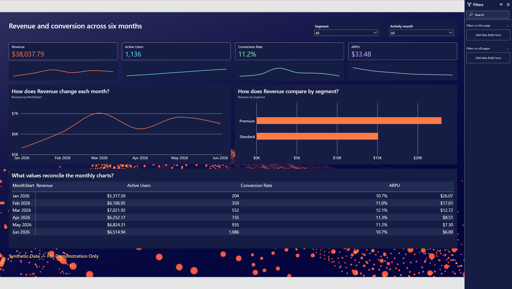
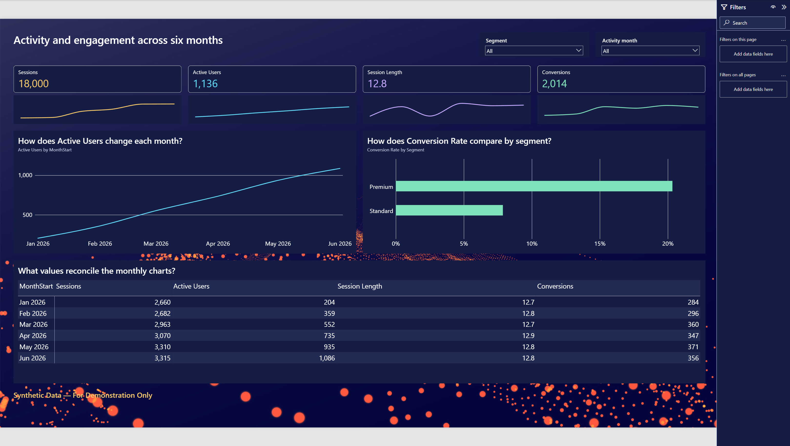

# Synthetic Power BI stakeholder preview

**Synthetic Data — For Demonstration Only**

An editable three-page Power BI dashboard built with a reusable Codex agent skill. It combines six months of synthetic events, a TMDL semantic model, native KPI and trend charts, and a Deneb cohort retention heatmap, styled with the navy/orange `template_1` background.

## Open the dashboard

Open [vibe_dashboarding_test.pbip](powerbi/vibe_dashboarding_test/vibe_dashboarding_test.pbip) in Power BI Desktop. Keep the sibling `.Report` and `.SemanticModel` folders together. After cloning, update Power Query parameter `pMockDataRoot` to the absolute path of `data/vibe_dashboarding_test`, then refresh. Enable PBIP/PBIR features if required by your Desktop version and allow the certified Deneb visual to load.

| Page | Preview |
| --- | --- |
| Performance | Revenue, active users, conversions, conversion rate, trends and segment comparisons |
| Engagement | Session length, sessions, conversions, activity trends and monthly summaries |
| Cohort Retention | Signup enrollment, eligible populations and Deneb retention heatmap |

The PBIP is the interactive dashboard preview. These screenshots were captured from that project in Power BI Desktop and reviewed on October 10, 2026. They show the saved demonstration with all slicers selected.

### Performance



### Engagement



### Cohort Retention


## Data and metrics

The demonstration covers January–June 2026, seed 42, 1,200 anonymous users and 18,000 events. [schema.yaml](config/schema.yaml) defines source tables and relationships; [metrics.yaml](config/metrics.yaml) defines Revenue, ActiveUsers, Conversions, ConversionRate, ARPU and SessionLength. [Dashboard configuration](config/vibe_dashboarding_test.yaml) and [metric extensions](config/vibe_metric_extensions.yaml) record generation and retention assumptions.

Retention counts distinct users active at a calendar-month age divided by enrolled users eligible for that observed month. Age zero is not forced to 100%; future cells are blank. Distinct users and ratios are recomputed in context rather than summed across groups. Signup cohort and segment slicers filter retention consistently.

## Use the agent again

Open this repository in Codex and invoke the [powerbi-preview-builder skill](.agents/skills/powerbi-preview-builder/SKILL.md). [AGENTS.md](AGENTS.md) supplies repository conventions. Modes include INIT, GENERATE_DATA, BUILD_MODEL, BUILD_REPORT, BUILD_DENEB, REFINE, VALIDATE and PREPARE_PREVIEW.

```text
Use $powerbi-preview-builder in REFINE mode to add a segment comparison
on the Performance page of powerbi/vibe_dashboarding_test/vibe_dashboarding_test.pbip.
Preserve Desktop-saved changes and the existing metric contracts.

Use $powerbi-preview-builder in VALIDATE mode for vibe_dashboarding_test.
Reconcile metrics, run official PBIR validation and review rendered pages.
List all checks that are NOT VERIFIED.

Use $powerbi-preview-builder to build a new synthetic stakeholder preview
in a separate PBIP folder using my supplied schema, metrics and background.
```

For new dashboards, supply business questions, schemas, metric definitions, date ranges and design constraints. New domain schemas require a matching generator and metric oracle; the shipped generator implements an event/user fixture. The agent preserves existing files, uses feature branches for substantial work, and requires authorization before pushing or publishing.

Microsoft `powerbi-report-cli` and `semantic-model-authoring` are declared in [apm.yml](apm.yml) and pinned in [apm.lock.yaml](apm.lock.yaml). Restore these dependencies through your APM setup before authoring. Installed upstream skill copies and downloaded tools are excluded from Git. See the [official Codex skills guide](https://learn.chatgpt.com/docs/build-skills).

## Repository map

| Path | Contents |
| --- | --- |
| `powerbi/vibe_dashboarding_test/` | PBIP, report, model and approved design brief |
| `data/vibe_dashboarding_test/` | Local synthetic CSV sources |
| `config/` | Schemas, metrics, assumptions and tool versions |
| `templates/` | Backgrounds, themes, layouts and Deneb specifications |
| `scripts/`, `tests/` | Generation, reconciliation and validation |
| `docs/vibe_dashboarding_test/` | Dictionary, reconciliation and validation evidence |
| `.agents/skills/powerbi-preview-builder/` | Reusable agent instructions and references |

## Validate and reproduce

Run from the repository root with Python and the official authoring CLI:

```powershell
python -m pip install -r requirements.txt
python scripts/tooling.py doctor
python scripts/validate_data.py --data data/vibe_dashboarding_test --config config/vibe_dashboarding_test.yaml --docs docs/vibe_dashboarding_test
python -m unittest discover -s tests -v
python scripts/validate_project.py
powerbi-report-author validate powerbi/vibe_dashboarding_test/vibe_dashboarding_test.Report
```

The original build passed 14 unit tests, local reconciliation, Microsoft TMDL parsing and Deneb schema/compilation checks. Official PBIR validation also passed on the Desktop-saved report with zero errors and warnings. These checks do not establish Import refresh, DAX engine correctness or rendered appearance. See [validation evidence](docs/vibe_dashboarding_test/validation_report.md). The user reviewed the result; all three pages were subsequently captured and visually reviewed by the agent. Import refresh and direct DAX-engine reconciliation remain NOT VERIFIED.

`build_vibe_data_model.py` and `build_vibe_report.cjs` reproduce the seed baseline and overwrite generated model/report files. Use a separate copy or deliberate branch before regeneration. The original `validate_vibe_model.ps1` serializes the model and assumes the baseline table count; do not run it unchanged against Desktop-added date tables.

Version source, configurations, specifications and synthetic fixtures. Exclude credentials, caches and downloaded tools. Binary PBIX files are preserved locally; the PBIP is the canonical Git artifact.

